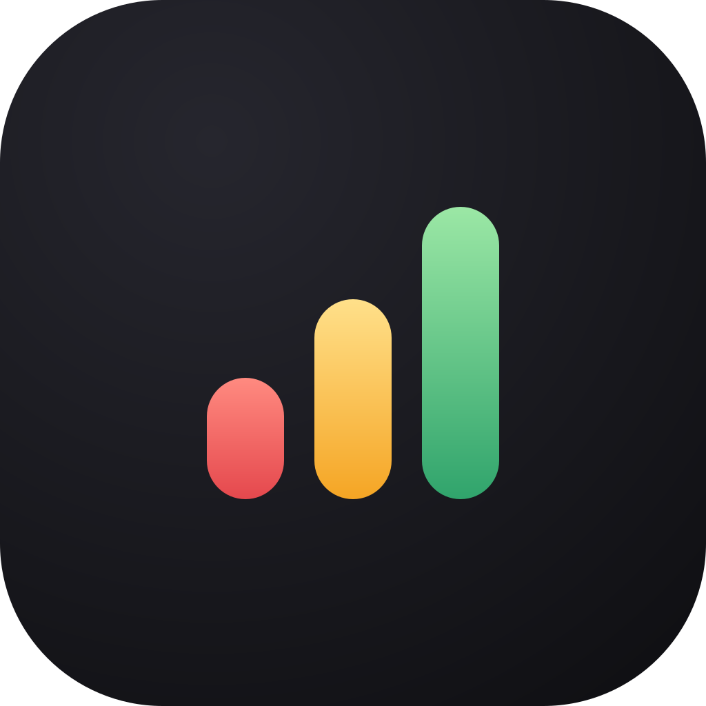

# schools.bye

Быстрый и удобный дневник [schools.by](https://schools.by) для Android. Неофициальное приложение.

## Что умеет

- Расписание и домашние задания по неделям
- Темы уроков, заметки учителя и прикреплённые файлы
- Новые отметки — сразу видно, что поставили
- Итоги: отметки за четверть, полугодие и год, средний балл
- Цель по каждому предмету — какие отметки нужны, чтобы выйти на желаемую
- Свои цвета отметок
- Обновляется само

## Установка

1. Открой [последний релиз](../../releases/latest) и скачай файл `.apk`.
2. Открой его на телефоне. Если Android спросит — разреши установку из этого источника.
3. Войди с логином и паролем от schools.by.

Нужен Android 7 или новее.

## Безопасность

- Логин и пароль отправляются только на schools.by. Пароль на телефоне не хранится.
- Каждую версию перед публикацией проверяют на трекеры и через VirusTotal — результаты есть в описании релиза.
- Приложение проверяет подлинность обновления перед установкой.

---

Для разработчиков: [docs/CONTEXT.md](docs/CONTEXT.md).
